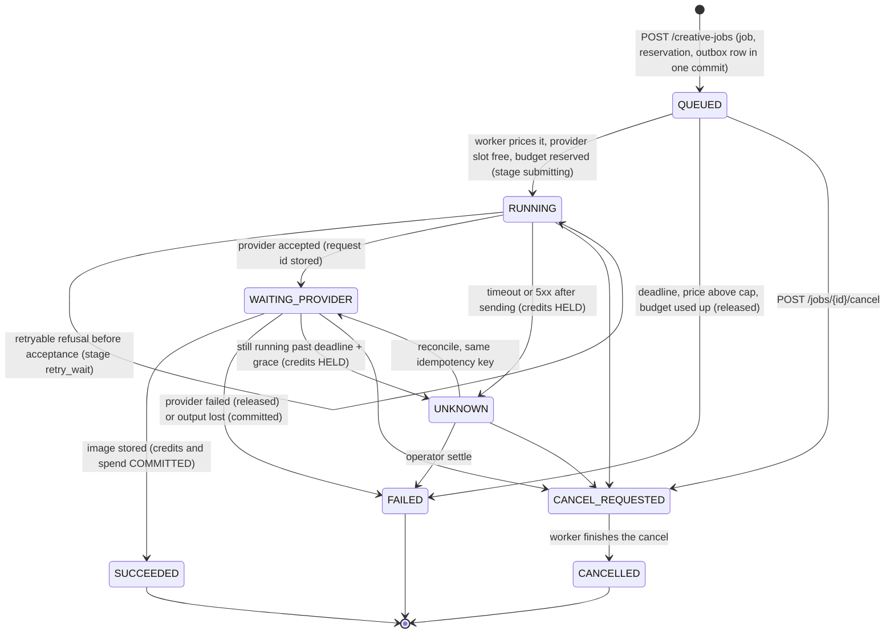

# Durable generation jobs: states, cancel, replay and settle (NRC-6)

Operator runbook for image generation jobs. The API accepts a job and the connector worker
(`app.workers.connector`) runs it. Each job holds credits (`credit_reservations`) and a share of the
global provider budget (`provider_spend`). This page covers what each state means, how a cancel
ends, and how an operator replays or settles a job the worker stopped on.

Ids only in tickets and chat: tenant, job and provider request ids. Never paste prompts, provider
responses, keys or presigned URLs.

## States



- `SUCCEEDED`, `FAILED` and `CANCELLED` are final. Every state change is a guarded update, so a
  late or repeated event never moves a final job.
- `stage` says where a job is within its state: `submitting`, `retry_wait`, `waiting_provider`,
  `fetching_output`, `output_ready`, `stored`, `reconcile`.
- Credits (`credit_reservations.state`): `RESERVED` while the job runs. `HELD` when the provider may
  have billed it and nobody knows yet. `COMMITTED` when billed. `RELEASED` when nothing was billed.
  Provider spend follows the same rule.

## Cancel

`POST /v1/marketing/jobs/{job_id}/cancel` (capability `generation:run`):

- Moves any unfinished job to `CANCEL_REQUESTED` and makes its run event due now. If the worker had
  given up on the job, it adds a new run event.
- Repeating it returns the current state. A `SUCCEEDED` or `FAILED` job gets 409
  `JOB_NOT_CANCELLABLE`.

The worker then ends the job as `CANCELLED`. `failure_code` says what the cancel cost. It is not an
error:

| Where the job was | failure_code | Credits and spend |
|---|---|---|
| Never sent to the provider | `CANCELLED` | released |
| Accepted, the provider later failed it | `CANCELLED` | released |
| Accepted, the provider completed it | `CANCELLED_AFTER_COMPLETION` | committed; the image is never fetched, stored or published |
| Maybe sent with no request id, still running past deadline + grace, or the status can't be read | `CANCELLED_OUTCOME_UNKNOWN` | HELD for an operator (see Settle) |

A job that may have reached the provider is never resent to find out, because a resend would bill a
generation the user cancelled.

Known edge case: if the provider's final answer arrives at the same moment as the cancel, the job
can end `FAILED` instead of `CANCELLED`. Credits and spend are correct either way.

## Jobs that wait for an operator

```bash
uv run python -m scripts.list_unknown_jobs
```

This runs as the database owner (`MIGRATION_DATABASE_URL`) in a read-only transaction. It prints one
line per job: `tenant=<id> job=<id> state=<state> code=<failure_code>`. It lists:

- `UNKNOWN` jobs the worker stopped on (no run event pending), for example code
  `ATTEMPTS_EXHAUSTED`, `PROVIDER_STILL_RUNNING` or `MODEL_CHANGED`;
- `CANCELLED` jobs with code `CANCELLED_OUTCOME_UNKNOWN`.

Their credits stay HELD and count against the tenant's daily ceiling until settled.

### 1. Check the outcome with the provider

The provider idempotency key is `nrc-job-<job id>`. Look the job up in the provider's console or
billing records by that key, or by the request id shown in `GET /v1/marketing/jobs/{id}`. Note
whether it was billed and, if the provider states it, the actual cost.

### 2a. Replay: let the worker try again

Use this only for `UNKNOWN` jobs, when the cause has gone away (for example a provider outage, or a
key that has now been rotated back):

```bash
uv run python -m scripts.job_operations replay --tenant <tenant id> --job <job id> \
    --operator <your operator id> --reason "<why, for the audit trail>"
```

This adds a new run event and restarts the deadline. The worker then resends the identical request
with the job's own idempotency key, so the provider returns the original request and never bills
twice. Replay is refused (exit code 2, `JOB_OPERATION_NOT_ALLOWED`) when the job is finished, is not
`UNKNOWN`, or still has a run event pending. A `FAILED` job is never reopened: start a new job
instead.

### 2b. Settle: record what the provider did

```bash
uv run python -m scripts.job_operations settle --tenant <tenant id> --job <job id> \
    --billed [--actual-usd 0.081] --operator <your operator id> --reason "<evidence reference>"
uv run python -m scripts.job_operations settle --tenant <tenant id> --job <job id> \
    --not-billed --operator <your operator id> --reason "<evidence reference>"
```

- `--billed` commits the credits and the provider spend: the actual cost if you give one,
  otherwise the stored estimate. `--not-billed` releases both.
- An `UNKNOWN` job becomes `FAILED` with code `OPERATOR_SETTLED_BILLED` or
  `OPERATOR_SETTLED_NOT_BILLED`. A `CANCELLED` job stays `CANCELLED`.
- Once a job is settled nothing is HELD, so a second settle is refused.

Both commands connect as `marketing_worker` (`WORKER_DATABASE_URL`). That role can't list tenants,
which is why `--tenant` is required. Each action writes one row to `job_operator_actions`
(operator, reason, state and credits before and after, and for a replay the event it added), in
the same transaction as the change. The table is insert-only: no role may update or delete a row.
The commands print ids and codes only; the reason is never logged.

## Admission and provider limits

| Limit | Setting | What happens at the limit |
|---|---|---|
| Active jobs per tenant | `GENERATION_MAX_ACTIVE_JOBS_PER_TENANT` | 429 `GENERATION_LIMIT_REACHED`, `details.reason=ACTIVE_JOB_LIMIT` |
| Credits per tenant per 24 h | `GENERATION_DAILY_CREDIT_CEILING_PER_TENANT` | 429, `details.reason=CREDIT_CEILING` |
| Spend per provider, all tenants | `GENERATION_GLOBAL_BUDGET_USD` | job fails `BUDGET_EXHAUSTED` before submit |
| Generations per provider at once, all tenants and workers | `GENERATION_MAX_IN_FLIGHT_PER_PROVIDER` | job waits `QUEUED` (no failure counted, estimate kept); past `GENERATION_DEADLINE_SECONDS` it fails `DEADLINE_EXCEEDED` with credits released |
| Transient provider failures in a row, per worker | `PROVIDER_CIRCUIT_FAILURE_THRESHOLD`, `PROVIDER_CIRCUIT_OPEN_SECONDS` | new estimates and submits pause for the open period; polls and fetches go on |

A job being cancelled keeps its active slot until the worker finishes the cancel, unless it was
parked (`output_ready`) or `UNKNOWN`. Workers are a fixed pool polling the outbox, so no request
starts a worker. Adding worker replicas never raises the provider cap, because the cap is checked
under a database lock shared by all workers.

`GENERATION_MAX_IN_FLIGHT_PER_PROVIDER` defaults low (4) until the provider confirms its concurrency
quota. Set it to that quota or lower. Many `DEADLINE_EXCEEDED` failures on jobs that never left
`QUEUED` mean the cap (or the deadline) is too low for the load, not a provider fault.

## Crash recovery (what to expect, nothing to do)

- The API answers 202 only after the job, its reservation and its outbox row commit together. A
  failed request leaves nothing behind, and a retry with the same Idempotency-Key creates the job
  once.
- If a worker dies, its lease expires and another worker takes the event. Before calling the
  provider, the worker commits the move to `submitting`. After a crash it therefore reconciles with
  the same key and never submits a new request.
- A crash after storing an image but before the commit leaves no asset row and no charge. The S3
  object may stay behind as an orphan.
- Tests for each crash window: `tests/test_crash_windows.py` (credits, spend, assets and events
  are checked by `tests/ledger.py`).

## Not built yet

SQS queues and DLQs per stage, Step Functions and EventBridge (follow-ups F41, owners Dinesh and
Prabhu). Today the worker leases outbox rows from Postgres directly, and this runbook covers that
path.
